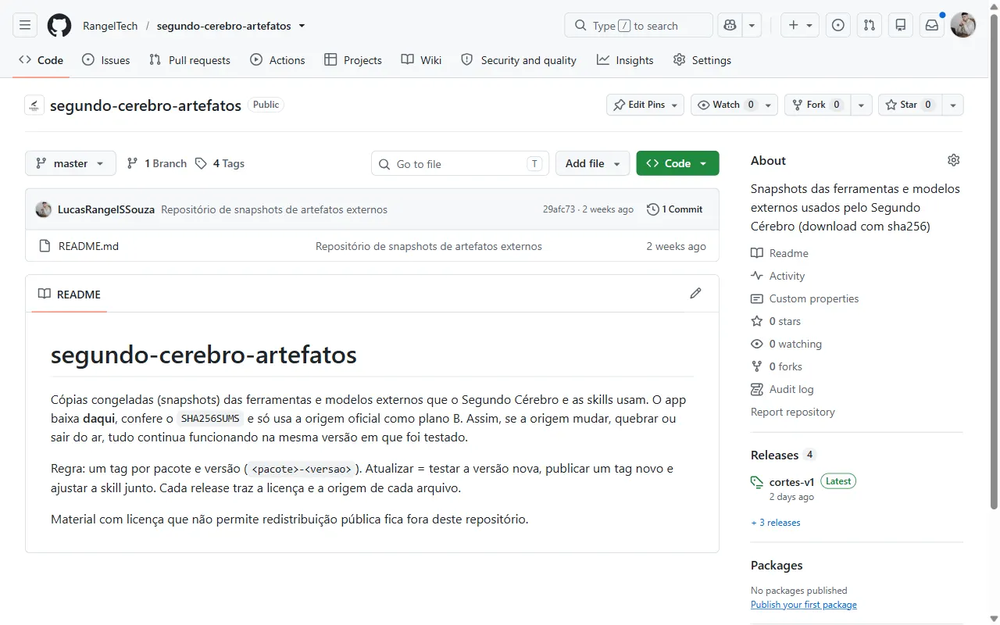

<!-- readme-padrao -->
# Segundo Cérebro: artefatos

> Cópias congeladas (snapshots) das ferramentas e modelos externos que o Segundo Cérebro baixa, com SHA256 e licença; a origem oficial é só plano B.

## O que é
Cópias congeladas (snapshots) das ferramentas e modelos externos que o Segundo Cérebro baixa, com SHA256 e licença; a origem oficial é só plano B.

Estado: **no ar (releases baixadas pelos apps)**.

## Onde está no ar
- Sem endereço público próprio.

## Onde faz o deploy
Não tem deploy na VPS principal (no ar (releases baixadas pelos apps)).

## Como funciona por dentro
Resumo acima; os detalhes estão nas notas técnicas (README anterior) abaixo e na spec 57.

## Segredos
Nenhum valor de segredo fica neste repositório. Os segredos dos serviços ficam no Infisical (mapa em `vps_rt_infra/scripts/infisical/mapa_envs.json`) e chegam à VPS gerados no deploy.

## Rodar e testar localmente
Ver as notas técnicas abaixo (cada repositório tem o seu jeito); os testes de QA em produção são por cliques reais, com evidência em `new_ragente/qa/evidencias`.

## Links
- Repositório: https://github.com/RangelTech/segundo-cerebro-artefatos
- Painel único: https://painel.rangeltech.net
- Spec de organização geral: `new_ragente/specs/57_ORGANIZACAO_GERAL_PRODUTOS_E_PAINEL.md`

## Notas técnicas (README anterior)

# segundo-cerebro-artefatos

Cópias congeladas (snapshots) das ferramentas e modelos externos que o Segundo Cérebro e as skills usam. O app baixa **daqui**, confere o `SHA256SUMS` e só usa a origem oficial como plano B. Assim, se a origem mudar, quebrar ou sair do ar, tudo continua funcionando na mesma versão em que foi testado.

Regra: um tag por pacote e versão (`<pacote>-<versao>`). Atualizar = testar a versão nova, publicar um tag novo e ajustar a skill junto. Cada release traz a licença e a origem de cada arquivo.

Material com licença que não permite redistribuição pública fica fora deste repositório.
